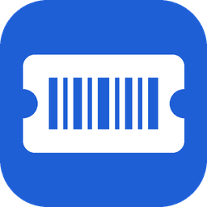
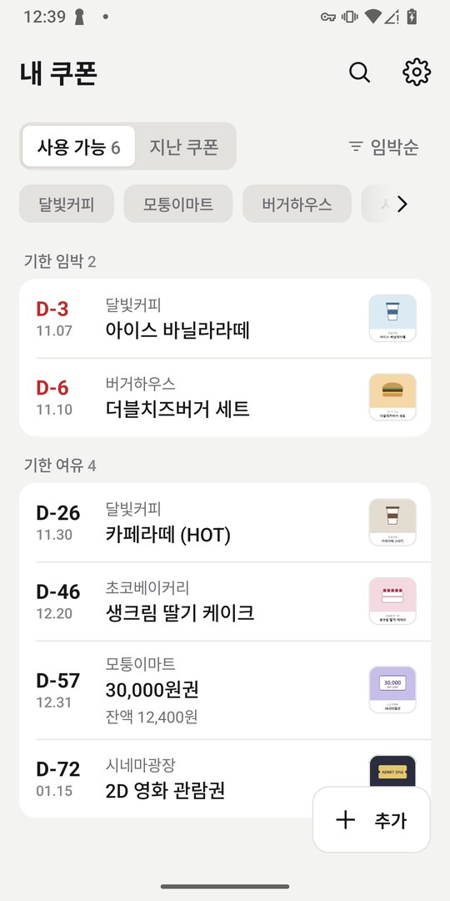
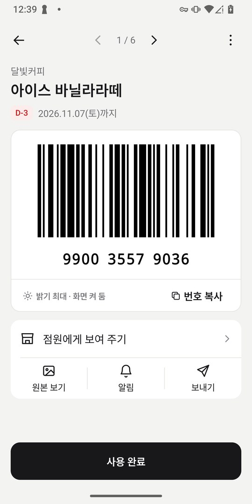
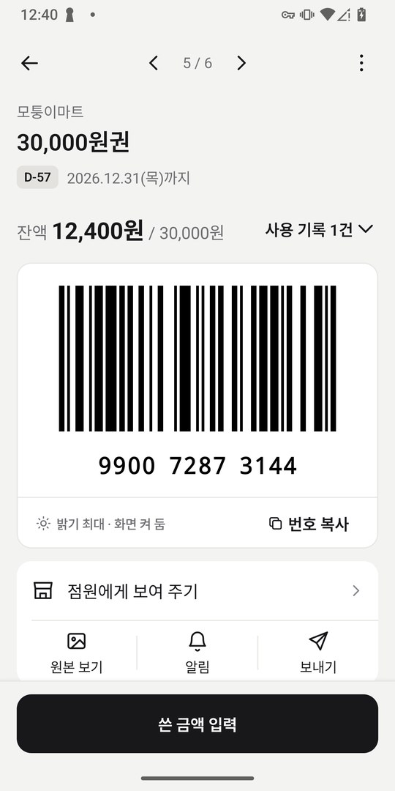
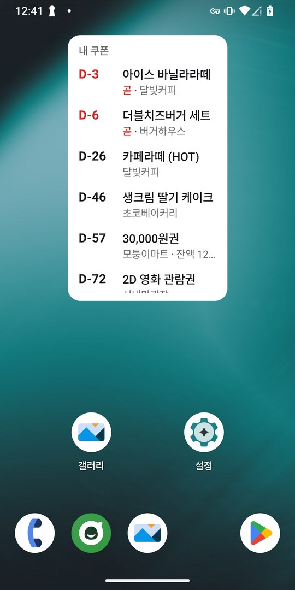

<div align="center">



# 내 쿠폰

**받은 기프티콘 사진을 고르면, 폰 안에서 읽어서 정리해 주는 안드로이드 앱**

브랜드, 상품명, 유효기간, 바코드 번호를 알아서 채우고, 끝나기 전에 알려 주고,<br>
계산대에서는 바코드를 크게 띄워 줘요. 가입도 인터넷도 필요 없어요.

### [최신 릴리즈 (APK)](https://github.com/ouor/my-coupon/releases/latest)

</div>

> [!NOTE]
> **인터넷 권한이 아예 없는 앱이에요.** <br/>
> 쿠폰 사진을 읽는 일(OCR)도 폰 안에서 끝나고, 쿠폰 정보는 어디로도 보내지 않아요.
> 쿠폰을 사고팔거나 다른 사람과 함께 쓰는 기능은 없어요.

## 📸 이렇게 써요

1. **쿠폰 넣기**: 카카오톡이나 문자에서 기프티콘 사진을 길게 눌러 **공유 → 내 쿠폰**을 고르거나, 앱에서 **＋ 추가 → 사진 고르기**로 한 번에 30장까지 골라요. **갤러리에서 쿠폰 찾기**를 누르면 사진첩에 묻혀 있던 쿠폰 캡처를 찾아 줘요.
2. **확인하기**: 읽은 결과가 카드로 나와요. 확실하지 않은 칸은 "확인 필요"로 표시되고, 원본 사진 조각을 옆에 보여 줘서 바로 고칠 수 있어요.
3. **계산대에서**: 목록에서 쿠폰을 누르면 화면이 최대 밝기로 바뀌고 바코드와 번호가 크게 나와요. 다 쓰면 **사용 완료**를 눌러요.

<div align="center">




</div>
<div align="center"><sub>쿠폰 목록 · 바코드 화면 · 금액권 잔액 · 홈 화면 위젯 (모두 가상의 쿠폰)</sub></div>

## ✨ 할 수 있는 것

- **한국어 쿠폰을 정확하게 읽기**: PP-OCRv5 한국어 모델로 폰 안에서 읽고, 쿠폰에 맞춘 규칙으로 브랜드·상품명·유효기간·번호·금액을 골라내요. 바코드는 그림에서 직접 해독해서 번호를 맞춰 봐요.
- **확실하지 않으면 묻기**: 날짜 후보가 여러 개이거나 글자가 흐리면 조용히 넣지 않고 "확인 필요"로 알려 줘요. 영수증처럼 쿠폰이 아닌 사진은 걸러 내고, 이미 넣은 쿠폰은 다시 넣지 않아요.
- **갤러리에서 쿠폰 찾기**: 최근 1·3·12개월 사진 중 쿠폰처럼 보이는 것만 골라 줘요. 한 번 본 사진은 다음에 건너뛰어요. '선택한 사진만 허용'으로도 쓸 수 있어요.
- **만료 알림**: 7일 전, 1일 전, 당일 아침에 알려 줘요. 하루에 한 번만, 여러 장이면 한 알림으로 묶어요. 알림의 **바코드 열기**로 바로 사용 화면이 열려요.
- **계산대용 바코드**: 밝기 최대, 화면 꺼짐 방지, 번호는 네 자리씩 크게. **점원에게 보여 주기**를 누르면 가로로 바코드만 꽉 차게 보여 주고, 길게 눌러야 닫혀요.
- **실수해도 괜찮게**: **사용 완료**를 잘못 눌러도 8초 안에 되돌릴 수 있어요. 이미 쓴 쿠폰을 열면 빨간 경고와 함께 바코드가 흐리게 나와요.
- **금액권 잔액**: 쓴 금액이나 남은 금액을 넣으면 잔액과 기록이 남아요. 바코드 화면을 띄워 놓고 깜빡했으면 다음에 "아까 썼어요?" 하고 물어봐요.
- **위젯과 빠른 설정 타일**: 홈 화면에서 곧 끝나는 쿠폰을 보고, 빠른 설정에서 바로 쿠폰을 열어요.
- **백업과 복원**: 비밀번호로 잠근 파일 하나로 내보내고, 새 폰에서 가져와요. 서버 없이 파일로만 옮겨요.
- **보기 편하게**: 다크 모드(바코드 칸은 흰색 유지), 시스템 글꼴 200%까지, TalkBack 읽기 문구.

### 이럴 때 써 보세요

- 카카오톡 선물함과 사진첩에 쿠폰이 흩어져 있어서 계산대 앞에서 한참 찾을 때
- 받은 쿠폰을 기간이 지나서 못 쓴 적이 있을 때
- 다른 쿠폰 앱이 한국어 상품명이나 날짜를 자꾸 틀리게 읽어서 직접 고치다 지쳤을 때
- 금액권을 나눠 쓰는데 얼마 남았는지 매번 헷갈릴 때

## ⬇️ 설치하기

1. [최신 릴리즈](https://github.com/ouor/my-coupon/releases/latest)에서 `.apk` 파일을 받아요.
2. 받은 파일을 열어요. "출처를 알 수 없는 앱" 안내가 나오면 **설정**을 눌러 이 출처(브라우저나 내 파일)를 허용해요.
3. Play 프로텍트 경고가 뜨면 **세부정보 더보기 → 무시하고 설치**를 눌러요. Play 스토어를 거치지 않은 앱이라 뜨는 안내예요.

**업데이트**는 새 버전 APK를 그대로 설치하면 돼요. 넣어 둔 쿠폰과 설정은 그대로 남아요.

이 저장소의 [릴리즈](https://github.com/ouor/my-coupon/releases)에서 받은 APK만 설치해 주세요. 정식 APK의 서명 인증서 SHA-256 지문은 아래와 같아요.

```
0F:AC:6E:14:69:5A:C5:79:E5:99:75:14:0C:3B:1B:B0:34:EC:1A:8B:32:46:86:71:7C:D2:68:B8:EC:31:49:03
```

PC에서 `apksigner verify --print-certs mycoupon-*.apk`로 확인할 수 있어요.

### 필요한 것

- Android 8.0 이상, 64비트(arm64) 휴대폰. 2017년 이후 나온 휴대폰은 대부분 해당돼요.
- 인터넷은 필요 없어요.
- 앱 화면은 한국어로만 나와요.

## 🔒 개인정보

- 앱에 **인터넷 권한이 없어요.** 쿠폰 사진, 읽은 글자, 바코드 번호는 이 폰 밖으로 나가지 않아요. 안드로이드 자동 백업에도 들어가지 않아요.
- 저장되는 건 **넣은 쿠폰 정보와 쿠폰 이미지 복사본, 금액권 사용 기록, 설정**이고, 모두 폰 안에만 있어요. 설정의 **모든 데이터 삭제**로 한 번에 지울 수 있어요.
- 백업 파일은 내가 정한 비밀번호로 잠겨요(Argon2id + AES-GCM). 비밀번호를 잊으면 열 수 없어요.
- 쓰는 권한
  - **사진**: 갤러리에서 쿠폰 찾기를 쓸 때만 물어봐요. 허용하지 않아도 사진을 직접 골라 넣을 수 있어요.
  - **알림**: 만료 알림을 보낼 때 써요.
  - 카메라 권한은 쓰지 않아요. 카메라로 찍기는 휴대폰 기본 카메라 앱을 빌려 써요.
- 계정, 광고, 분석 도구가 없어요.

## 🙋 자주 묻는 질문

| 이럴 때 | 이렇게 해 보세요 |
|---|---|
| 설치가 안 돼요 | "출처를 알 수 없는 앱" 허용을 확인해 주세요. 32비트 휴대폰이나 Android 8.0 미만에서는 설치되지 않아요. |
| 카카오톡 선물함 쿠폰은 어떻게 넣어요? | 선물함에서 쿠폰을 열고 **이미지 저장**을 누른 뒤, 앱에서 **사진 고르기**로 골라요. 앱의 **＋ 추가 → 카카오톡 선물함 쿠폰 넣는 법**에도 같은 안내가 있어요. |
| 읽은 내용이 틀렸어요 | 쿠폰을 열고 메뉴(⋮) › **수정**에서 고쳐요. 등록할 때 "확인 필요"가 붙은 칸은 원본 조각을 보면서 고를 수 있어요. |
| 쿠폰이 아닌 사진이 들어왔어요 | 등록 화면에서 **쿠폰 아님 · 빼기**를 누르거나, 등록한 뒤라면 메뉴(⋮) › **삭제**로 지워요. |
| 갤러리에서 쿠폰을 못 찾아요 | 바코드가 없는 상품권(PIN 번호만 있는 것)은 자동으로 못 찾을 수 있어요. **사진 고르기**로 직접 넣어 주세요. |
| 알림이 안 와요 | 휴대폰 설정에서 내 쿠폰 알림이 켜져 있는지 확인해 주세요. 알림은 하루 한 번, 설정한 시각에 와요. |
| 바코드가 계산대에서 안 읽혀요 | **점원에게 보여 주기**로 가로로 크게 띄워 보세요. 그래도 안 되면 **원본 보기**로 받은 이미지를 그대로 보여 줄 수 있어요. |
| 새 폰으로 옮기고 싶어요 | 설정 › **백업·복원**에서 파일로 내보내고, 새 폰에 앱을 설치한 뒤 같은 화면에서 가져와요. |

문제가 계속되면 [이슈](https://github.com/ouor/my-coupon/issues)에 휴대폰 기종과 증상을 남겨 주세요. 쿠폰 사진이나 바코드 번호는 올리지 마세요.

---

## 🛠️ 개발자 노트

여기부터는 앱을 직접 빌드하거나 고치려는 분을 위한 내용이에요.

- 빌드 방법과 구조: [docs/BUILDING.md](docs/BUILDING.md)
- 인식 규칙과 정확도: [docs/ocr/](docs/ocr/) (Python 기준 구현은 [ocr-lab/](ocr-lab/))
- 기획·디자인·리뷰 기록: [docs/](docs/)
- 쓰인 기술
  - 앱: Kotlin, Jetpack Compose (Material 3), Hilt, Navigation Compose
  - 인식: PP-OCRv5 (mobile det + korean mobile rec), ONNX Runtime, ZXing
  - 저장: Room, WorkManager, Glance(위젯)
  - 백업 암호화: Bouncy Castle (Argon2id)
- 이 앱은 쿠폰 발급사나 카카오와 관련이 없어요. 상품명과 브랜드의 권리는 각 회사에 있어요.
